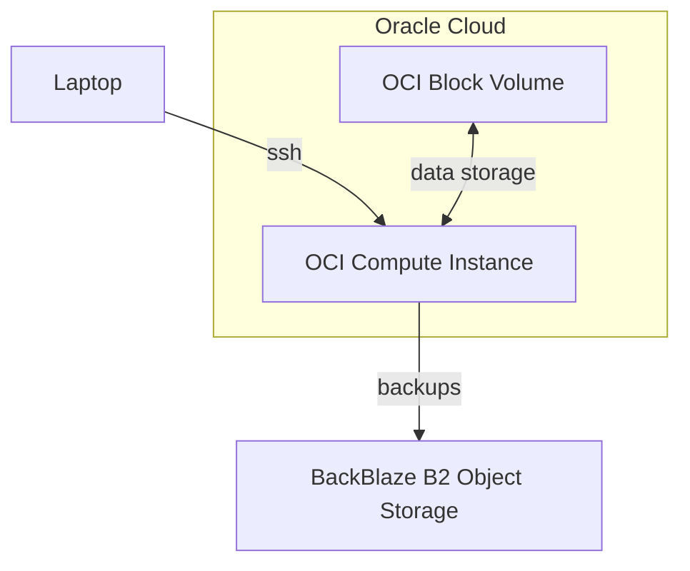

# Usage
1. Create a hosts file in `inventory/hosts`. It should look like:

```
[production]
<some ip or FQDN>
```
2. Install docker: `ansible-galaxy collection install community.docker`


To run commands, use `ansible-playbook -e @secrets_file.enc --ask-vault-pass -i inventory/hosts <playbook_name>.yml`




## Secrets
To add a new secret, run `ansible-vault edit secrets_file.enc`.

## Dependencies

```bash
python3 -m pip install --user pipx
python3 -m pipx ensurepath
pipx install --include-deps ansible --force
ansible-galaxy collection install community.docker
```

## Backup Failures
If backup-oci-block fails due to an OCI issue or other issue, there may be an extra block volume lying around. To find it, run 

```bash
/home/sam/bin/oci bv volume list --lifecycle-state AVAILABLE
```

Find the temporary one (look at `time-created`, it's probably recent), and delete:

```bash
/home/sam/bin/oci bv volume delete --volume-id <volume-ocid> --force
```

## Upgrades
Every third-party image is pinned to a version, and so is mailcow (`mailcow_version` in `mail.yml`), so nothing upgrades unless a commit changes it. [Renovate](https://github.com/apps/renovate) (`renovate.json`) checks every Saturday morning and opens a PR for each new version; merging to `master` runs the deploy workflow.

- Patch releases of low-risk images merge on their own.
- Immich, mailcow, databases, and anything minor or major wait for review. Read the release notes first, and run a block volume backup before upgrading Immich, mailcow, or a database.
- Database major versions are never proposed; those need a manual dump/restore.
- Own images (`ghcr.io/samc1213/*`) and Immich's postgres image are not tracked.
